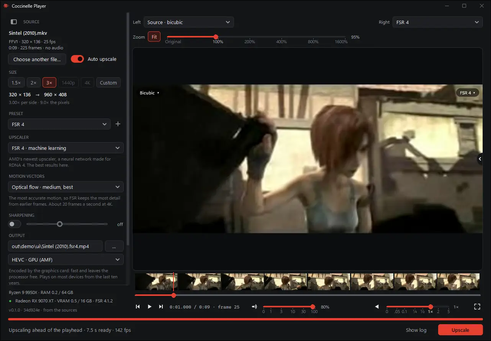

# Coccinelle Player

A Windows video player that upscales what it plays with **AMD FSR Upscaling 4**, the machine-learning
upscaler of the Radeon RX 9000 series. Open a video or an image, watch it upscaled while it is being made,
compare it with the source, and save the result.



*Left of the divider, the source enlarged with bicubic; right of it, FSR 4 at 3x.*

> [!WARNING]
> **Written by an AI, tested by a human.** Claude (Anthropic's AI model) wrote the code, the tests and this
> documentation, in Claude Code: mostly Claude Opus 5.5, after a first version by Claude Fable 5.1, with a few
> changes by Claude Fable 5.2, at the extra-high ("xhigh") effort level. Still, the player was manually tested,
> on Windows 11 with a Radeon RX 9070 XT.

## Features
- **Watch while it upscales.** The upscaler follows the playhead and keeps everything it made. When it is
  slower than the video, playback waits with a spinner, like a streaming site.
- **Five upscalers to save with.** FSR 4.1.2 (default), FSR 3.1.6, FSR 2.3.4, AMD's HQ scaler and Real-ESRGAN,
  with presets of your own.
- **Compare anything.** A divider splits the picture. Each side shows an upscaler preset or the source enlarged
  by a classic filter (Bilinear, Bicubic, Lanczos, original pixels) as a reference, paused or playing, zoomed up
  to 1600%. The filters are only for comparing: they are what any player already does.
- **Save the result.** Upscale finishes the file and writes it with HEVC, AV1 or H.264 on the GPU, or x264 and
  x265. Every audio track, the subtitles, the chapters and the title are kept.
- **A real player.** Frame steps, 0.05x to 5x forwards or backwards, full screen.
- **A command line** (`fsr4`) for scripts and batches.

### Supported files
Anything ffmpeg decodes, including:
- **Video:** MP4, MKV, MOV, AVI, WMV, WebM, MPG, VOB, TS, M2TS, FLV, 3GP, OGV, MXF, DV, RealMedia.
- **Images:** PNG, JPEG, BMP, TIFF, WebP, EXR, GIF (first frame).
- **Saved as:** MP4 (default), MKV or MOV for videos; PNG (default), JPEG or WebP for images.

HDR video is tone-mapped to SDR and interlaced video is deinterlaced. Details: [Files](docs/files.md).

## Installation
1. Download the zip from the [latest release](https://github.com/TermWay/coccinelle-player/releases/latest)
   and unzip it anywhere.
2. Double-click `install-all.bat` in that folder. It installs ffmpeg, which the player needs and does not
   include, then Real-ESRGAN, an optional upscaler. Each one also has its own script: `install-ffmpeg.bat`,
   `install-realesrgan.bat`.
3. Double-click `Coccinelle Player.exe` and drop a video on the window.

The executables are not code-signed, so Windows SmartScreen may warn about them (More info, then Run anyway).
Each release publishes the SHA-256 of its zip: compare it with `Get-FileHash <zip> -Algorithm SHA256` first.

### Or build it yourself
With [Python 3.12](https://www.python.org/downloads/) and git, in a terminal:

```
git clone https://github.com/TermWay/coccinelle-player.git
cd coccinelle-player
python -m pip install -r requirements-build.txt
.\build_exe.bat
```

The same two executables land in `dist\fsr4\`. The script downloads AMD's FSR DLLs from
[AMD's FidelityFX SDK](https://github.com/GPUOpen-LibrariesAndSDKs/FidelityFX-SDK) and refuses them unless they
match their pinned SHA-256. To run from the source without building, see [Development](docs/development.md).

### What you are running
- **All of this project's code is Python you can read**, here; there is no compiled code of its own. The only
  binaries it ships are AMD's FSR DLLs, signed by AMD and checked against pinned hashes, and what PyInstaller
  packs around the code: Python with Tcl/Tk, numpy and OpenCV (their versions are pinned in `requirements.txt`).
- **It has no network code.** The only web address in it is Real-ESRGAN's download page, shown in a message.
  It runs other programs only to do its work: ffmpeg and ffprobe, and Real-ESRGAN when you install it. Only the
  install scripts download, from where they say (winget's ffmpeg package, Real-ESRGAN's release, checked
  against its SHA-256); they are short batch files, readable in Notepad.
- **Release zips are built by GitHub**, not on a personal computer: [a workflow](.github/workflows/release.yml)
  builds each one from the tagged commit and signs a record of where it comes from. With the
  [GitHub CLI](https://cli.github.com/), `gh attestation verify <zip> --repo TermWay/coccinelle-player` checks a
  download against that record.
- **To run only what you have read**, build it yourself as above, from the same commit as the release's tag.

## Requirements
- **Windows** and a **Radeon RX 9000** card (FSR 4's FP8 model) with a current Adrenalin driver. AMD's
  requirements also name the RX 7000 series (FSR 4's INT8 model; the RX 6000 series appears only in AMD's
  timings): untested here.
- **Other cards:** on a card the FSR DLL offers no FSR 4 for, FSR 4 is refused with the reason (never swapped
  for FSR 3.1 behind its name), and FSR 3.1, FSR 2.3, AMD's HQ scaler and Real-ESRGAN still run. `fsr4 info`
  lists what the DLL offers your card.
- **ffmpeg 5.1 or later**, with ffprobe, on PATH or next to `fsr4.exe` (6.0 or later for the AV1 GPU encoder,
  8.0 or later for AMD's HQ scaler). All decoding and encoding goes through it. `install-ffmpeg.bat` installs
  it with winget (`winget install Gyan.FFmpeg.Essentials`); copying `ffmpeg.exe` and `ffprobe.exe` next to
  `fsr4.exe` also works.
- **Optional, for the Real-ESRGAN upscaler:** `install-realesrgan.bat` downloads
  `realesrgan-ncnn-vulkan-20220424-windows.zip` from
  [Real-ESRGAN's release v0.2.5.0](https://github.com/xinntao/Real-ESRGAN/releases/tag/v0.2.5.0), checks its
  SHA-256 and unzips it into `bin\realesrgan\` next to it. Unzipping it there by hand, or putting it on PATH with
  its `models` folder beside it, also works. It is a separate program under its own license (BSD 3-Clause) and
  is not included.

**Linux** is not supported at the moment: AMD ships FSR 4 only as signed Windows DLLs, and the window draws, plays sound,
takes dropped files and goes full screen through Win32. The Windows build may run under Wine or Proton;
untested. **macOS** is not supported: AMD ships FSR 4 for Windows only, and Apple silicon Macs have no Radeon.

## Using the window
1. **Open** a video or an image: drop it on the window, or Choose file (Ctrl+O).
2. **Pick a size** in the sidebar: 1.5×, 2×, 3×, 1440p, 4K or Custom.
3. **Play** (Space). The seek bar shows what is already upscaled; seek anywhere and the upscaler follows.
4. **Compare:** drag the divider, and choose what each side shows in the Left and Right lists above the
   picture. The zoom slider goes up to 1600%.
5. **Upscale** (Ctrl+Enter) finishes the file from the playhead and saves it next to the source.

Every setting explains itself when the pointer rests on it. With **Auto upscale** switched off, files open as
in a plain player and upscaling starts only when you pick a preset.

| Key | Action | Key | Action |
|-----|--------|-----|--------|
| Space | play / pause | ← → | 5 seconds back / forward |
| , . | one frame back / forward | [ ] | slower / faster |
| F, F11 | full screen | R | play backwards / forwards |
| Ctrl+O | open a file | Ctrl+Enter | upscale and save |

The full guide, with every control and key: [Using the window](docs/window.md).

## Command line
```
fsr4 upscale clip.mp4                       # clip.fsr4.mp4, 2x, HEVC on the GPU, audio kept
fsr4 upscale photo.png --mode quality       # 1.5x
fsr4 upscale clip.mkv --scale 3 --codec x265 -o out.mp4
fsr4 info                                   # GPU and the FSR versions offered for it
```
Every option: [Command line](docs/command-line.md).

## How well it works
FSR 4 is a game upscaler: it expects depth, motion vectors and a camera jitter that a video does not have. The
tool computes the motion vectors with optical flow and fixes the rest, so on video FSR 4 works mostly as a very
good spatial upscaler with temporal stabilisation. Measured on an RX 9070 XT:

- **Speed:** the command line takes 1080p60 to 4K at 47 fps end to end, so 1080p30 upscales in real time. The
  window's default preset uses the most accurate motion, about 20 fps at 4K; faster presets are in the same
  list.
- **Quality:** on a panning test clip FSR 4 scores 0.4 to 0.7 dB above Lanczos, and 1.2 dB above itself
  without motion vectors. On natural footage Lanczos scores 0.4 dB higher, because PSNR rewards softness: it
  keeps 43% of the original's detail energy, FSR 4 112%.

The tables, the commands behind them and the cases where FSR 4 loses: [Measurements](docs/measurements.md).

## Limits
- No jitter and no real depth: FSR 4 cannot reconstruct here the sub-pixel detail it recovers in games.
- Input is processed as 8-bit. HDR video (PQ or HLG, as phones record) is tone-mapped to SDR, so the output is
  SDR; interlaced video is deinterlaced at its own frame rate (one picture per frame, not one per field).
- The player plays the first audio track and shows no subtitles; the saved file keeps every audio track, and
  the subtitles its container holds (all in .mkv; text ones, converted, in .mp4 and .mov).
- Tested on Windows 11 with an RX 9070 XT. If something fails on your machine, please open an issue with the
  text from Copy log (read it before posting, it names your files).

## More
- [Using the window](docs/window.md): every control and key.
- [Command line](docs/command-line.md): every option, and what FSR 4 lets a video tool change.
- [Files](docs/files.md): the formats, and how audio, subtitles, colour and frame rates are handled.
- [How it works](docs/how-it-works.md): what stands in for FSR's game inputs, and how playback works.
- [Measurements](docs/measurements.md): speed, encoders, quality against other upscalers, HDR.
- [Development](docs/development.md): running from the source, building the executables, tests, code layout.

## License
MIT (`LICENSE`) for this project's code. What it builds on keeps its own license:
- `third_party/ffx/`: AMD's FSR API headers, MIT; `fsr4/ffx.py` transcribes them. `third_party/vulkan_core.h`:
  Khronos, Apache-2.0 or MIT, used here under MIT (`third_party/LICENSE-Khronos.txt`); `fsr4/vk_types.py` is
  generated from it.
- The FSR DLLs (downloaded into `bin/`, not in the repository): AMD's signed binaries under AMD's FSR SDK license
  (`bin/license.md`), redistributable in binary form with that notice, which the exe ships next to them.
- The packaged app also holds Python, Tcl/Tk, numpy and OpenCV with the libraries they bundle, frozen by
  PyInstaller: their notices are in its `licenses\` folder.
- ffmpeg is not included: it runs as a separate program under its own license (GPL for the common builds).
- The executables are not code-signed: check a download against the SHA-256 published with it.

Not affiliated with AMD or the Khronos Group. AMD, Radeon and FidelityFX are trademarks of Advanced Micro
Devices, Inc.; Vulkan is a registered trademark of the Khronos Group Inc.

## Credits
Written by Claude (Anthropic's AI model) in Claude Code: the code, the tests and the documentation, to the
requirements in `SPEC.md`. Directed and manually tested by a human, this repository's maintainer.

The animation shows two clips, downscaled before upscaling: *Sintel* (© Blender Foundation,
[durian.blender.org](https://durian.blender.org), CC BY 3.0) and NASA's television broadcast of Apollo 11
(public domain).
